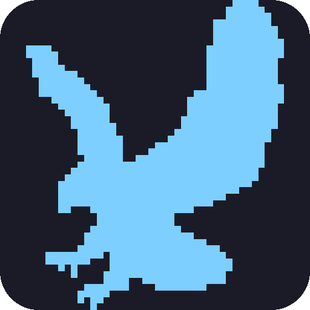

# The Hayato brand

**Hayato_** is a golden eagle on the wing: light enough to stay out of the way, fast enough to be
the first thing you reach for, and fun enough that the machine is a place you want to be. The
tagline is the whole promise: **light. fast. fun.**

Everything here is drawn in the default theme's own palette — Tokyo Night — so the brand never
repaints the desktop: it is the same cyan the bar and foot already use, plus one orange for the
cursor and the one warm accent.

## Files

| File | What it is | Rendered by `scripts/make-brand.sh` into |
|---|---|---|
| `mark-48.txt` | the mark, a 48×48 character grid — **the source of truth** | the SVGs below |
| `hayato.svg` | the mark at 48×48, merged into horizontal runs | the icon theme's `48x48/apps/hayato.png` and `scalable/apps/hayato.svg` |
| `hayato-24.svg` | the mark sampled 2×2 cells per pixel | the icon theme's `24x24/apps/hayato.png` |
| `hayato-16.svg` | the mark sampled 3×3 cells per pixel | the icon theme's `16x16/apps/hayato.png`, `site/favicon` |
| `wallpaper.svg` | the default wallpaper, 1366×912 | `Pictures/Wallpapers/hayato.png` |
| `social-preview.svg` | the repository's social card, 1280×640 | `brand/social-preview.png` |
| *(in `make-brand.py`)* | the mark as half blocks | `~/.config/hayato/wordmark.txt` (fastfetch), `~/.config/hayato/screensaver.txt` (idle screen) |

The PNGs and the text art are committed, so a build host without `rsvg-convert` still builds an
image; only an edit to this directory needs the script. The landing page (`site/`) uses these files
directly: the Pages workflow copies `brand/` next to it.

**One drawing, every size.** The 48, 24 and 16 px icons and the terminal art are all sampled from
`mark-48.txt` — 1×1, 2×2 and 3×3 cells per pixel — so no size is a resample and the idle screen can
never drift from the launcher icon. Edit the grid, never the generated files.

## The name

*Hayato* (隼人) is an old Japanese word for a falconer — literally "falcon person", from 隼, the
peregrine. It is a word, not a theme: Hayato has no Japanese visual identity. No kanji or kana
appear in the mark, the wordmark, the wallpaper, the installer or the interface; the meaning lives
in prose like this paragraph and nowhere else. What the word carries is the promise — something
quick, trained and light, that comes back to your hand.

The bird is a **golden eagle**, not a falcon: *Aquila chrysaetos*, the raptor of open country, long
wings, fingered primaries, a golden nape. The name says how it moves; the eagle says what it is.

## The mark

- A golden eagle, wings raised, on a rounded **`#1a1b26`** tile in **`#7dcfff`**. Cells, not curves:
  the shape is a pixel grid, and every surface renders it with `shape-rendering="crispEdges"`.
- Minimum size **16 px**. The 16 px form is the same drawing sampled 3×3, so it stays a solid
  silhouette instead of dissolving into speckles.
- The eagle is dynamic — diving, wings up, talons forward — never perched and never heraldic.
- **No snake in the mark.** The serpent belongs to the idle screen only (see below).
- Don't recolour it, outline it, add a gradient or a shadow, rotate it, or crop it. On a light
  background, keep the tile: the tile is what carries the mark onto any surface.
- The source silhouette is a public-domain (CC0) eagle drawing, traced onto the grid; the grid is
  the artwork now.

## The wordmark

- **`Hayato_`**: `Hayato` in the theme's text colour, and the trailing underscore in orange — the
  cursor, the same accent the bar's current chip uses.
- Set in **JetBrains Mono ExtraBold** with tight tracking (about -0.05em).
- In running text the name is **Hayato** (no underscore, no colour). Identifiers stay `hayato`
  (`org.hayato.*`, `~/.config/hayato/`, `ID=hayato`).
- The tagline is **light. fast. fun.** — lowercase, full stops, one line. Never "lazy by design".
- In the bar, the mark is `H_`: the wordmark's first letter in the reading colour and the
  underscore in the bar's accent, split across two modules so the cursor can carry a colour.
  The eagle is an image, and a 30 px bar has no room for it; the letter is the wordmark, and
  the wordmark is the brand.

## The palette

The mark and the brand surfaces are fixed to Tokyo Night, the default theme; a logo does not change
with the wallpaper. The wallpaper does follow the theme, because the theme engine already ships
wallpapers per palette.

| Role | Colour | Contrast on the tile |
|---|---|---|
| Tile | `#1a1b26` | — |
| Eagle | `#7dcfff` | 10.0:1 |
| Cursor, warm accent | `#ff9e64` | 8.4:1 |
| Text | `#c0caf5` | 9.9:1 |
| Muted | `#565f89` | 3.1:1 |

The eagle and the cursor both clear 4.5:1, so the mark can carry text weight and the wordmark's
underscore is readable, not decorative.

## The idle screen

The screensaver keeps the pixel grammar: the same eagle, sampled to half blocks, above the wordmark
and the tagline, in the terminal's foreground colour so `tte` paints its own palette over it.

The **snake** is allowed here and nowhere else: a coiled block serpent under the wordmark, the
eagle's talons closing on it. It is art for the idle screen, never a logo, never a wallpaper, never
a sentence in the copy.

## Don'ts

- Don't put the eagle on a photo, a gradient, or a coloured panel other than the tile.
- Don't pair the mark with a Japanese glyph, a torii, a wave pattern or any other national motif.
- Don't use the eagle-and-serpent composition from a coat of arms: the mark is the bird alone.
- Don't stretch the wordmark, or set it in another family, or drop the orange underscore.
- Don't ship a fourth icon size sampled from the vector; add it to the grid sampling instead.
